## Odoo addons Examples. 

	Small addons examples of Python programming with the Odoo ERP framework.
    You will need to install Odoo 19.0 to use these examples.

	version: 19.0.1.1.0
    release: v19.1.1.0
	author: Joan A. Pinol
	author_nickname: japinol
	author_gitHub: japinol7
	author_twitter: @japinol
	Python: 3.14
	PostgreSQL v. tested: 18.6

## Older versions

    You can find these addons for Odoo 18.0 in the release: v18.1.0.0
    You can find these addons for Odoo 17.0 in the release: v17.0.1.0
    You can find these addons for Odoo 16.0 in the release: v16.0.1.0

## Odoo new addon: JAP Sales

### New Features

* Duplicate a sale line with the duplication button   on the right side of the line.
  * Only visible for user with group: Sale Duplicate Lines.
  * Users with the group 'Role Sales Squad' inherit this group.

* Duplicated lines will be marked with this icon on the most important views:   
  * One letter A within a solid circle. 

* Create an Invoice from Selected Sale Lines.
  * Only visible for user with group: Role Sales Squad.
  * You can select which lines to invoice.
  * You can also add an Invoice note that will be added to the created invoice.

* Display a list of all sales orders associated with the customer of the current order.
    * You can see all the orders on this list. 
    * But you can only open an order if you have the right permissions.
 

### New icons in order lines

Icon mark to duplicate an order line  

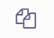  

Icon mark to show which lines are duplicated with this feature  

  

### How it works

Install (Activate) this addon modules: 
* JAP Sales
* JAP Customize Version
 

Note: The following addon modules will be automatically installed:
* JAP Addons Config
* JAP Security
 

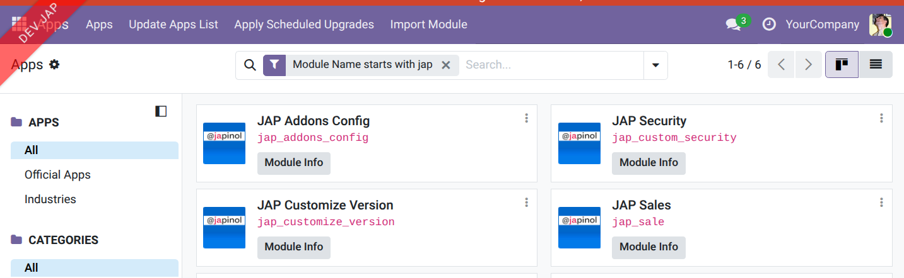    

You can check the JAP addons version and configuration    

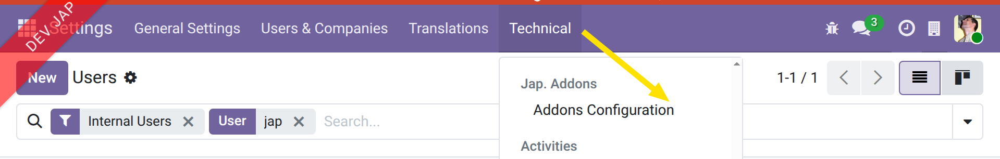    
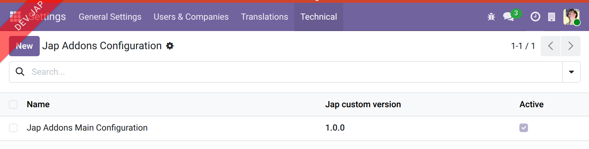    
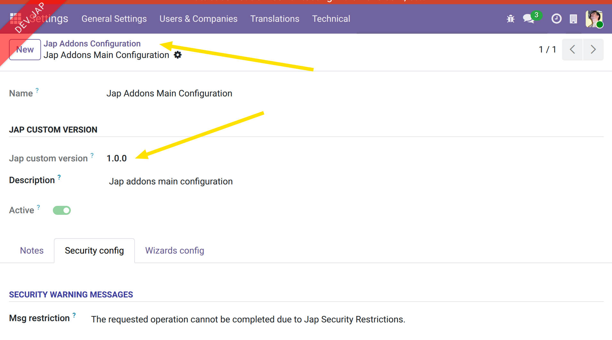    

Activate the 'Role Sales Squad' role for the chosen users    

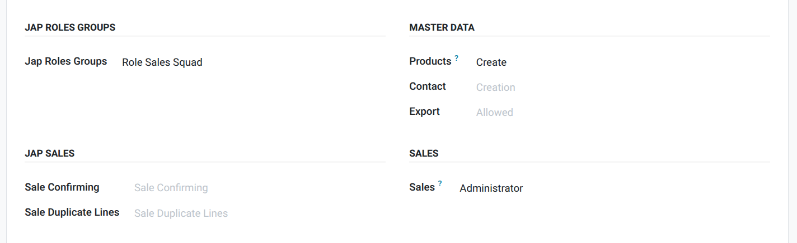    

A Sale or quotation will show a duplicate button for each line  
and an icon mark for a line created by duplication    

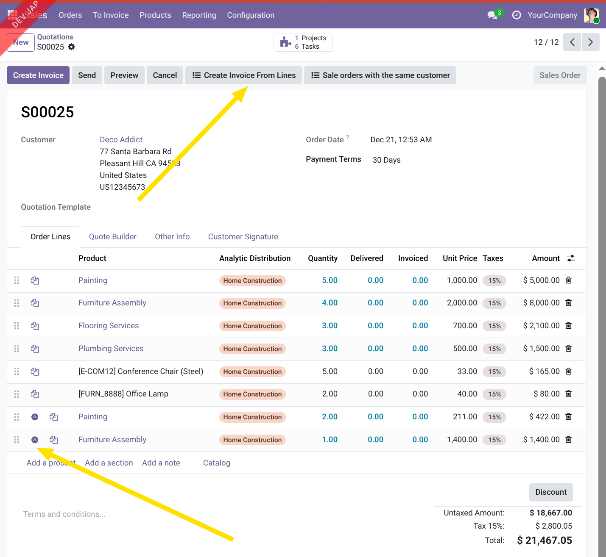    

#### Wizard that opens with the button 'Create Invoice from Lines'  
You can select which lines to add to the new invoice and add an internal note.    

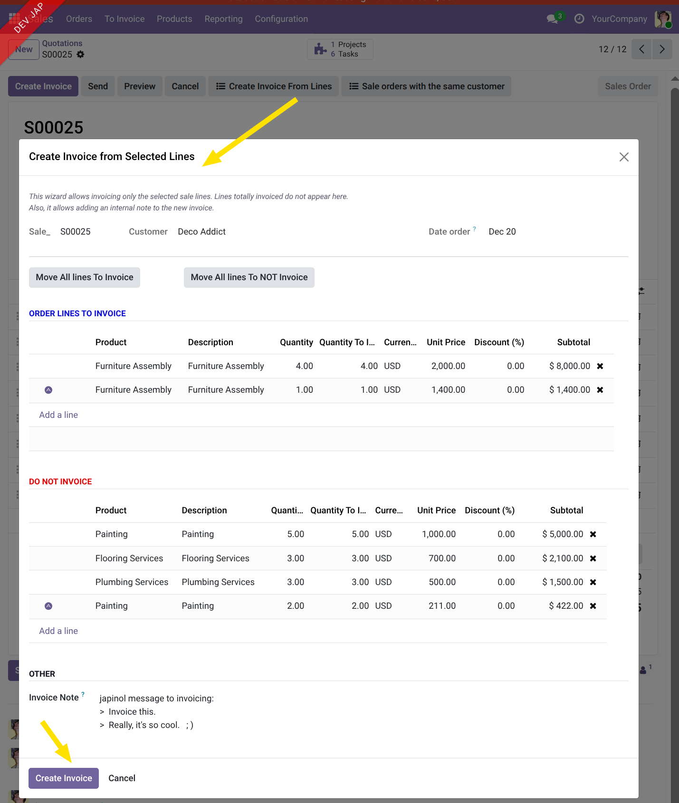    

#### Invoice created with the Wizard 'Create Invoice from Selected Lines'  
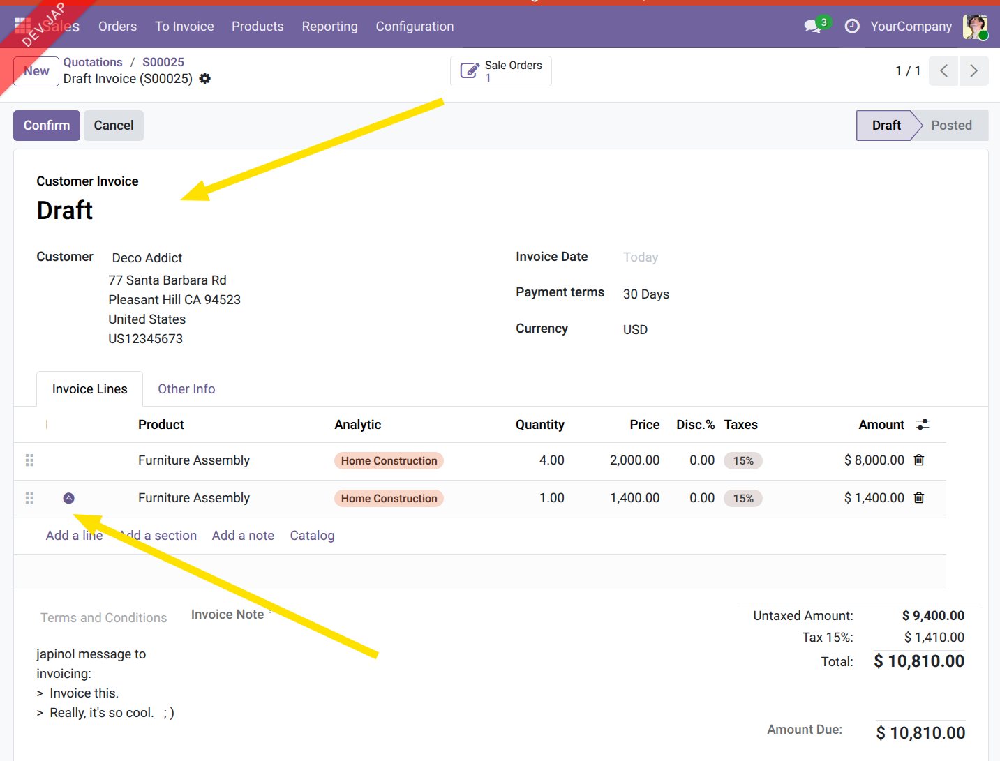    

#### Wizard that opens with the button 'Sale orders with the same customer'  
It displays a list of all sales orders associated with the customer of the current order.  
You can open a sale order from this wizard only if you have the right permissions. 
You can also open a second wizard to display the current sale order lines  
to help you choose the right order.   

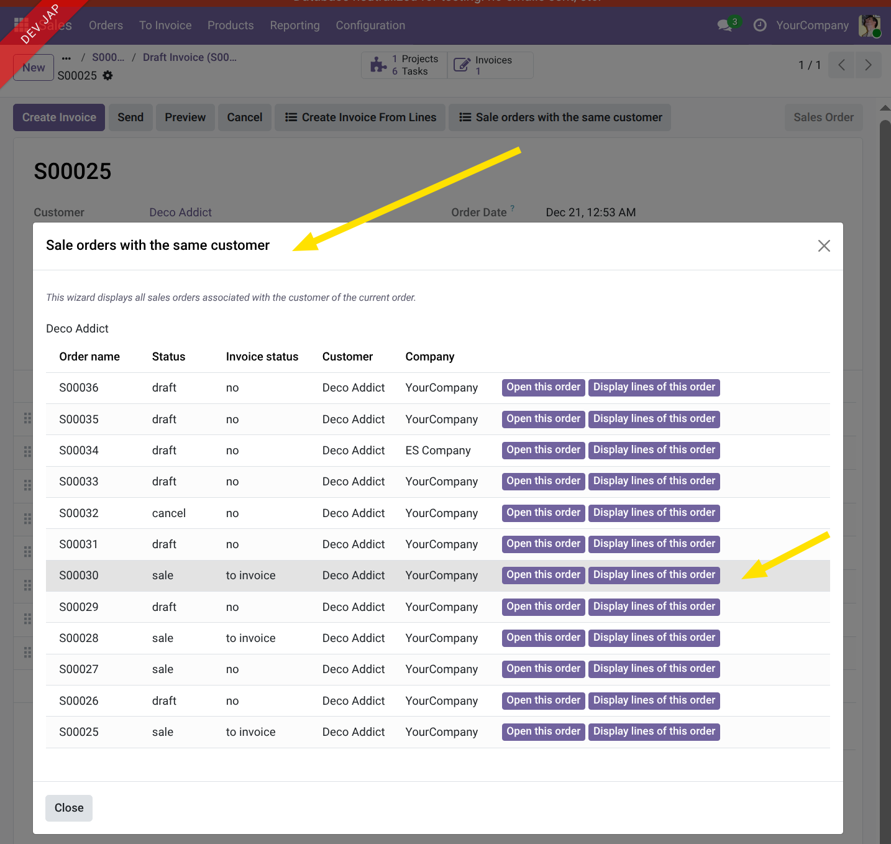    
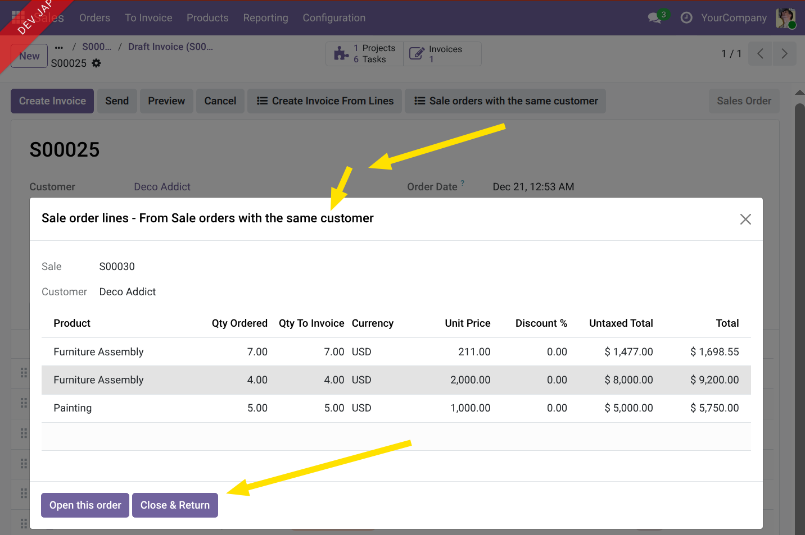    

### New features starting with release v19.1.1.0

#### New addon: 'JAP Simple Bulk Server Job'
A Technical addon intended to be used by System Administrators.

This addon allows creating special jobs able to process several records in bulk; 
a batch of N items per cron execution. 

It includes a Wizard to create jobs, views to manage them and a cron to execute the jobs.
* All the menus and views can be accessed from this menu:
Settings -- Technical -- Jap. Addons

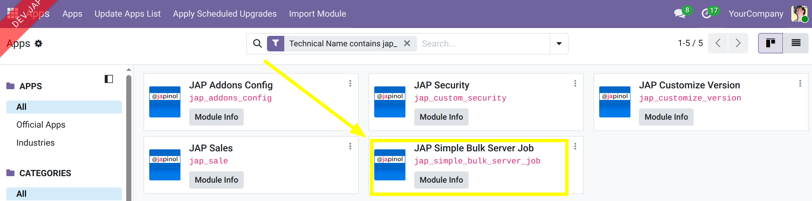    
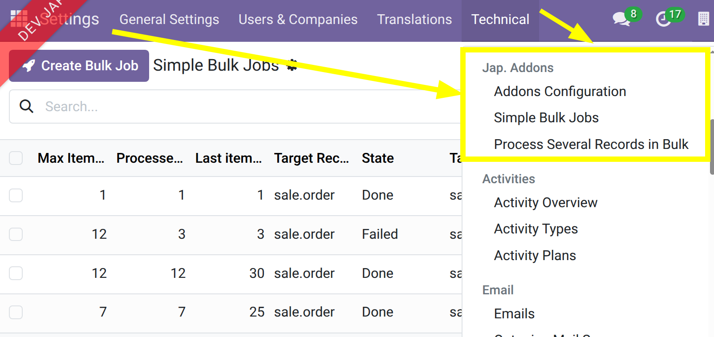    
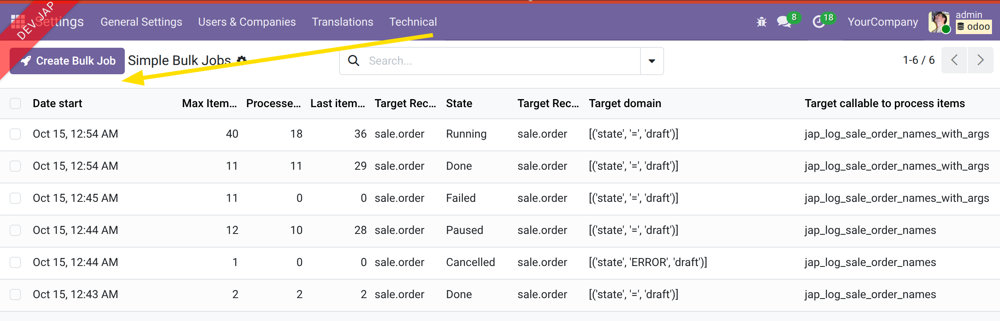    
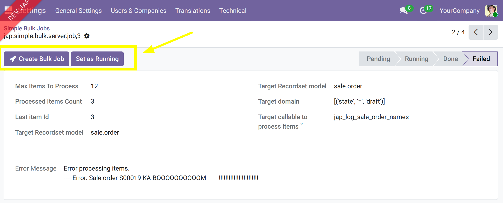    
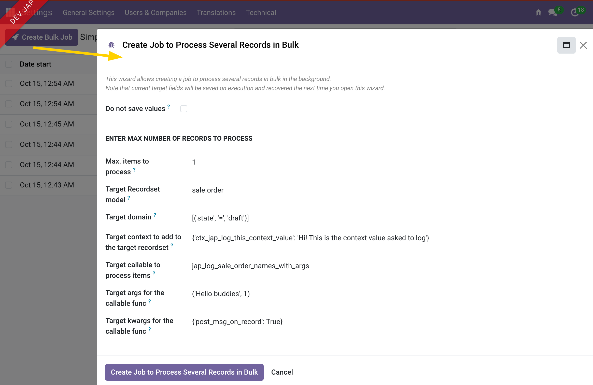    
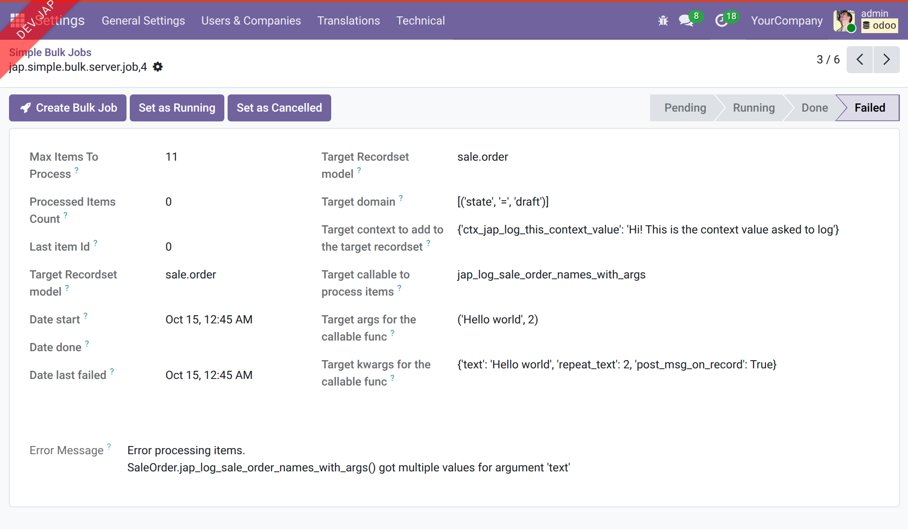    

.
